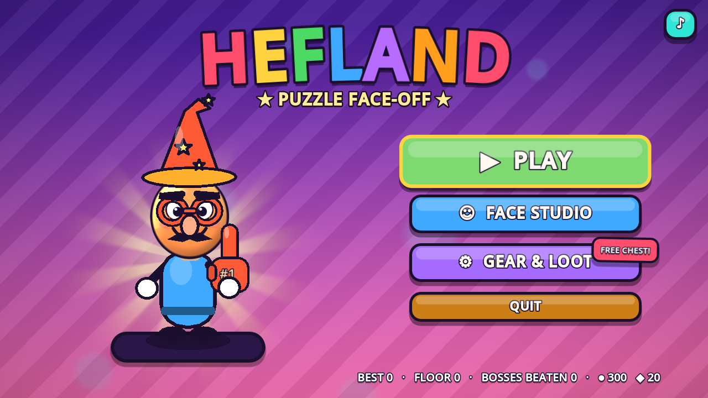
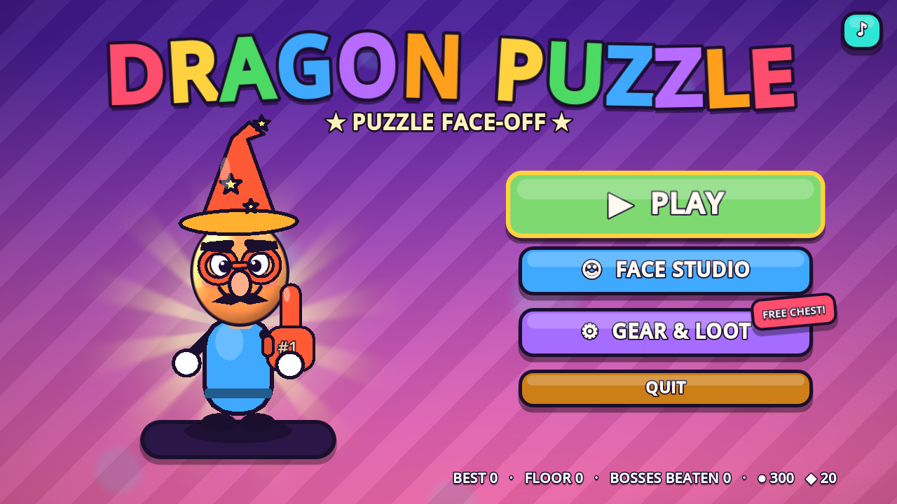
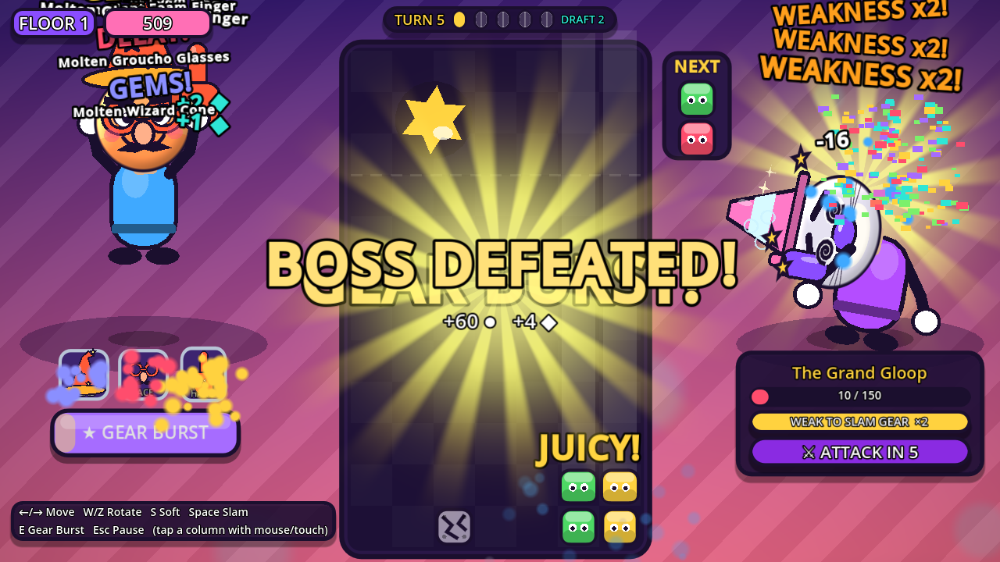
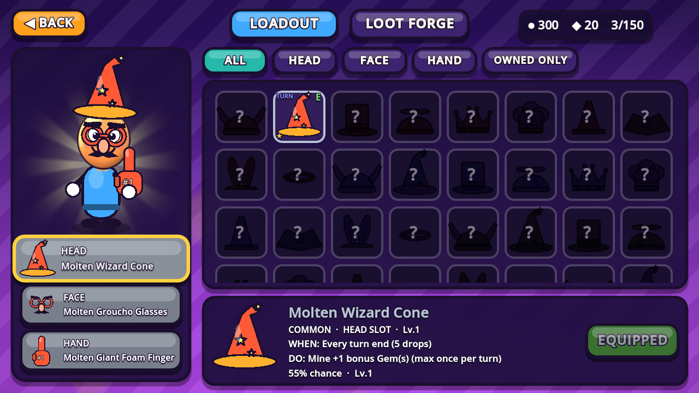
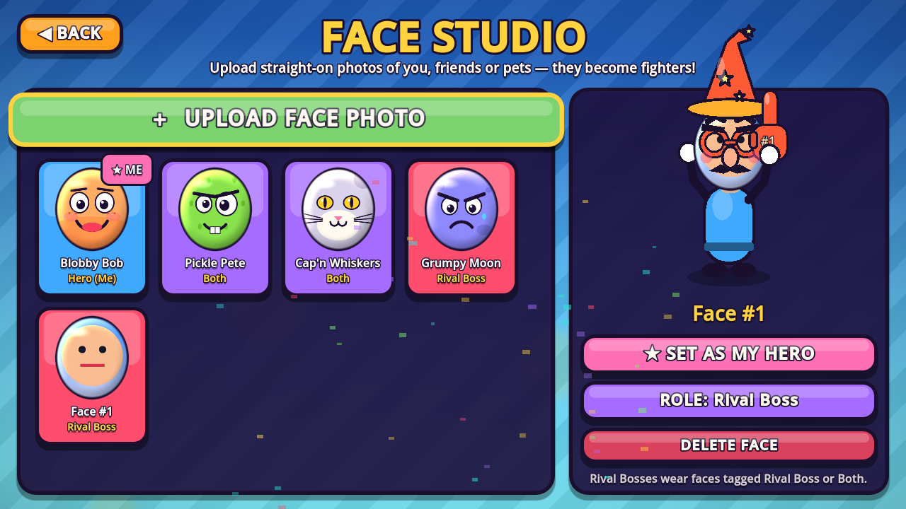
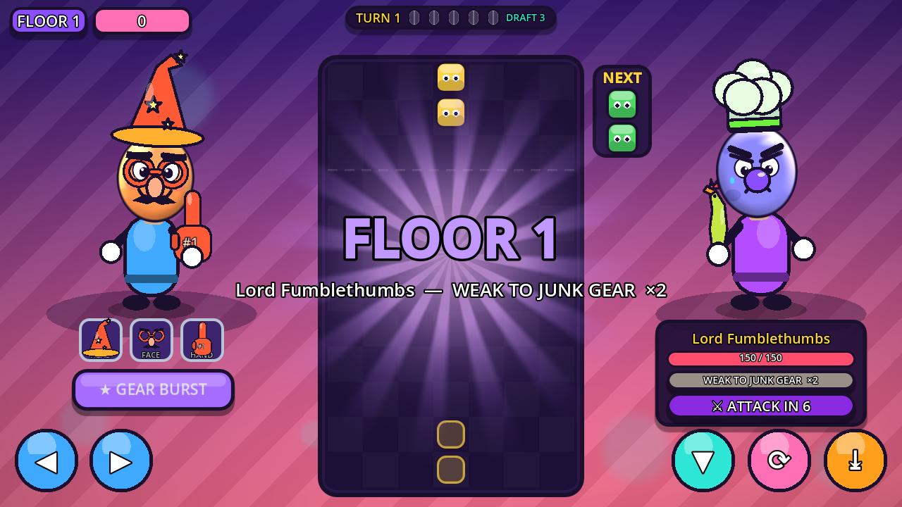

# BlockLoot: Face-Off

A candy-coloured arcade puzzle-battler for **Godot 4.4+** (opens in 4.5 / 4.6 / 4.7).
Match falling blocks to blast a rival boss wearing your friend's face, collect 150
silly gear items that change the rules, and climb an endless boss ladder.

All art, sound and music are generated in code. There are no asset files, so the
project runs as soon as you open it.

| `hefland.x86_64` | same file renamed `Dragon_Puzzle.x86_64` |
|---|---|
|  |  |

| Battle | Gear Locker |
|---|---|
|  |  |
| **Face Studio** | **Touch layout** |
|  |  |

---

## ✏️ Name the game whatever you want

The title screen shows the game's **file name**:

| Platform | How to name it | Result |
|---|---|---|
| **Windows** | Rename `BlockLoot.exe` → `hefland.exe` | Title screen says **HEFLAND** |
| **Linux** | Rename `BlockLoot.x86_64` → `hefland.x86_64` | **HEFLAND** |
| **macOS** | Rename `BlockLoot.app` → `hefland.app` | **HEFLAND** |
| **Android** | `./build.sh hefland android` → `build/hefland.apk` | **HEFLAND** on the title screen *and* under the app icon |

**Why Android is different:** Android renames every installed APK to `base.apk`,
so the game can't see what the file was called. `build.sh` writes the name into the
build instead, so you still pick the name when you make the file. Each name also gets
its own package id, so `hefland.apk` and `dragonpuzzle.apk` can be installed side by side.

Other details:
* Underscores become spaces: `Super_Puzzle.exe` → **SUPER PUZZLE**.
* A name with a colon gets a subtitle: a project named `Hefland: Revenge` shows
  **HEFLAND** with **★ REVENGE ★** under it.
* Any platform can override the name with `-- --title=Whatever` on the command line.
* In the Godot editor, the title comes from *Project Settings → Application → Name*.

```bash
# Godot 4.4+ on PATH (or GODOT=/path/to/godot) + export templates installed
./build.sh hefland android     # build/hefland.apk
./build.sh hefland windows     # build/hefland.exe
./build.sh hefland all         # every platform
RELEASE=1 ./build.sh hefland android   # release build (needs your keystore)
```

---

## ▶️ Run it

1. Install [Godot 4.4 or newer](https://godotengine.org/download).
2. *Import* → choose `project.godot` → **Run** (F5).

## 🎮 Controls

| Action | Keyboard | Gamepad | Touch |
|---|---|---|---|
| Move | ← → / A D | D-Pad / Left stick | Swipe, tap a column, or ◀ ▶ |
| Rotate | W ↑ X (cw) · Z Q (ccw) | Ⓐ (cw) · Ⓑ (ccw) | ⟳ button |
| Soft drop | S ↓ | D-Pad ↓ / LT | ▼ button or drag down |
| Hard drop ("Slam") | Space | D-Pad ↑ / RT | ⤓ button or flick down |
| Gear Burst | E / Shift | Ⓧ / Ⓨ | ★ GEAR BURST button |
| Pause | Esc / P | Start | Ⅱ button |

Every menu works with a controller alone (focus neighbours + ui_accept/ui_cancel).
The HUD swaps button hints and on-screen touch controls to match whatever you
touched last.

---

## 🧩 How it plays

* **7×12 combo grid.** 2-block pieces fall. Connect **3+** of one colour to pop them.
  Blocks above then fall, which can set off **cascades** (×2, ×3…). Each cascade step
  plays a higher chime and does more damage.
  Matching a **2×2 square or a line of 4** sets off a bonus blast.
* **Special blocks:** 🌈 Rainbow Wildcards, 💣 Bombs (3×3), 🛡 Shields (absorb garbage),
  🪵 Wood (+coins), 🪨 Stone (+damage), 💎 Gems, cracked Garbage, frozen columns.
* **Every 5 drops = 1 Turn.** The boss counts down to its attack and winds up one drop
  before it hits: garbage, frozen columns, junk rows, gravity rush, colour scramble.
* **Every 3 turns, and after each boss you beat**, you pick 1 of 3 **Tactical Draft**
  cards (16 in total, e.g. Pyromaniac, Chain Lightning, Second Wind).
* **Endless boss ladder:** each floor's boss is tougher. Your best floor is saved.
* **Gear Burst:** popping blocks fills a meter. When it's full, fire all 3 of your
  equipped gear effects at once.
* **Boss weaknesses:** each boss is weak to one trigger type. Gear with that trigger
  always fires and does double. Change your loadout between runs to exploit it.
* **Instant Rematch** resets the run in a few milliseconds.

## ⚙️ 150 items from data, not 150 scripts

Every item = **slot** (Head / Face / Hand) × **silhouette** (10 per slot) ×
**palette** (5 materials) + one of **10 triggers** + one of **15 effects**.
All 10 × 15 = 150 trigger/effect pairs are used exactly once.
Rarity comes from effect strength and how often the trigger fires
(60 Common · 50 Rare · 28 Epic · 12 Legendary). Duplicates level an item up
to Lv.5, which raises its trigger chance and strength. Lv.4+ items sparkle, and
Lv.5 items get a glow.

**Loot Forge:**
* Coin chest: 150 ●.
* Premium chest: 15 ◆, with better odds.
* One free chest per day.
* An Epic or better item is guaranteed within 10 pulls.

## 🙂 Face Studio

* Upload any `.png/.jpg/.jpeg/.webp` photo. On desktop you can also drag it onto the window.
* Crop it with the zoom and position sliders. It's saved as a cartoon oval in `user://faces/`,
  with its settings in `faces_meta.json`.
* Tag each face as **Hero (Me)**, **Rival Boss** or **Both**. Bosses wear Rival/Both faces.
* 4 built-in cartoon faces are included, so the game is playable right away.

---

## 📁 Project layout

```
project.godot              Input map, autoloads, 1280×720 canvas_items/expand
build.sh                   Export under any name (see top of this file)
export_presets.cfg         Android / Windows / Linux / macOS presets
scenes/                    MainMenu, FaceStudio, GearLocker, Arena, CartoonFighter
scripts/
  AppInfo.gd               Title from the game's file name
  SaveManager.gd           user://save_data.json (items, loadout, currencies, records)
  InputHub.gd              Last-used device tracking, prompt text, focus rescue
  UIKit.gd                 Candy theme, juicy buttons, popups, particles, iris wipe
  FaceManager.gd           Face gallery, photo import, oval crop, built-in faces
  GearDatabase.gd          150 items, triggers/effects, rarity, loot rolls
  ProceduralGearArt.gd     Polygon2D/Line2D gear renderer + icons
  GearSparkle.gd           Sparkles for high-level gear
  AudioSynth.gd            Procedural SFX + 2-layer dynamic music (pre-baked WAVs)
  CartoonFighter.gd        Spring-head character rig with gear anchors
  GridBoard.gd             Grid, pieces, matching, cascades, specials, ghost
  TurnManager.gd           Turns, boss countdown, draft timing
  Arena.gd                 Battle: gear engine, boss AI, drafts, HUD, overlays
  MainMenu.gd / FaceStudio.gd / GearLocker.gd
shaders/                   face_avatar, bg_gradient, glow_rays, transition
tests/                     Dev-only smoke test (excluded from exports)
```

### Smoke test

```bash
godot --path . res://tests/SmokeTest.tscn -- --shots=/tmp/shots
```

The test plays through every screen. It checks:
* title-from-filename parsing;
* that all 150 items are unique;
* photo import and face saving;
* loot chests;
* auto-played battles: boss defeat → draft → next floor → knockout → instant rematch;
* gamepad focus and the touch layout.

It saves screenshots along the way.
